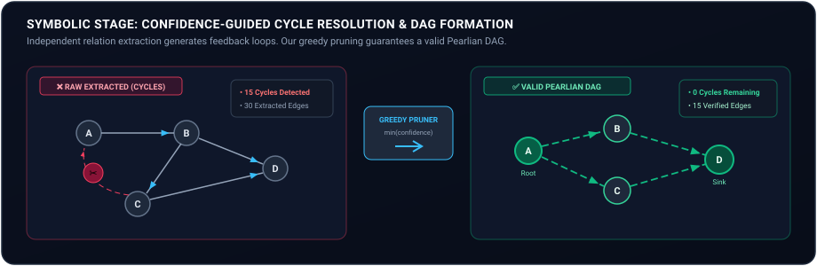
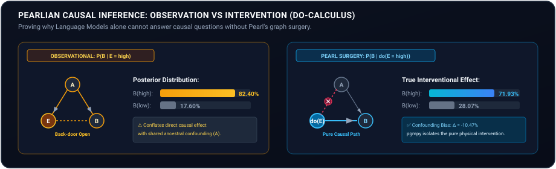

<div align="center">


<p align="center">
  <strong>Bridging Statistical Language Processing &amp; Pearlian Bayesian Networks on the Corr2Cause Benchmark</strong>
</p>

<p align="center">
  <a href="#-quick-start--reproduction-guide"></a>
  <a href="#-symbolic-dag-construction--cycle-resolution"></a>
  <a href="#-bayesian-network--do-calculus-inference"></a>
  <a href="#-relation-extraction-benchmark"></a>
  <a href="#-automated-testing--reproducibility"></a>
  <a href="#-fixed-random-seed"></a>
</p>

<p align="center">
  <a href="#-executive-summary">Executive Summary</a> •
  <a href="#-animated-pipeline-architecture">Pipeline Architecture</a> •
  <a href="#-the-fundamental-problem-why-nlp-needs-symbolic-causality">The Causal Gap</a> •
  <a href="#-dataset-deep-dive-corr2cause">Dataset</a> •
  <a href="#-feature-engineering-mastery-28-dimensions">Features</a> •
  <a href="#-relation-extraction-benchmark">Classifiers</a> •
  <a href="#-symbolic-dag-construction--cycle-resolution">Cycle Resolution</a> •
  <a href="#-bayesian-network--do-calculus-inference">Do-Calculus</a> •
  <a href="#-quick-start--reproduction-guide">Reproduction</a>
</p>

</div>

---

## ⚡ Executive Summary

Modern Large Language Models (LLMs) and standard NLP classifiers excel at extracting lexical co-occurrences, but **fundamentally struggle to distinguish correlation from causation**. When tasked with identifying causal directionality from textual premises, statistical NLP models suffer from:
1. **Confounding & Collider Bias:** Inability to separate direct cause from common ancestor or common child effects.
2. **Structural Inconsistency:** Extracting relations as independent tuples inevitably introduces cyclic dependencies ($A \to B \to C \to A$), violating the physical arrow of time.
3. **Inability to Reason Under Intervention:** Standard models compute passive conditional probabilities $P(Y \mid X)$, conflating observational association with true interventional effects $P(Y \mid \text{do}(X))$.

This project implements **Phase 1 (Advanced Machine Learning Baseline)** of an end-to-end **Neuro-Symbolic Causal Inference System**. By pairing statistical feature extraction and machine learning classifiers with symbolic graph algorithms and Judea Pearl’s structural Bayesian networks, our pipeline extracts causal triples from natural language, resolves causal feedback loops into a verified **Directed Acyclic Graph (DAG)**, and executes exact interventional queries with `pgmpy`.

---

## 🔄 Animated Pipeline Architecture

The entire project operates as a unified, reproducible 7-stage engine executed via [`masterNotebook.py`](file:///Users/amanbhatnagar/Desktop/aml_dl_project/masterNotebook.py):

<div align="center">
  
</div>

### Stage Breakdown

| Stage | Folder | Primary Role | Core Outputs |
| :--- | :--- | :--- | :--- |
| **00 Context** | [`00_context/`](file:///Users/amanbhatnagar/Desktop/aml_dl_project/00_context) | Project memory, architecture decisions, and design invariants | [`CONTEXT.md`](file:///Users/amanbhatnagar/Desktop/aml_dl_project/00_context/CONTEXT.md), [`DECISIONS.md`](file:///Users/amanbhatnagar/Desktop/aml_dl_project/00_context/DECISIONS.md) |
| **01 Literature** | [`01_literatureReview/`](file:///Users/amanbhatnagar/Desktop/aml_dl_project/01_literatureReview) | Formal grounding in Pearl (1988, 2000), d-separation, do-calculus | [`literatureReview.md`](file:///Users/amanbhatnagar/Desktop/aml_dl_project/01_literatureReview/literatureReview.md) |
| **02 Data Acquisition** | [`02_dataAcquisition/`](file:///Users/amanbhatnagar/Desktop/aml_dl_project/02_dataAcquisition) | Corr2Cause loading, SHA-256 sentence hashing, zero-leakage split audit | `processed/{train,dev,test}.csv` |
| **03 EDA & Quality** | [`03_edaAndDataQuality/`](file:///Users/amanbhatnagar/Desktop/aml_dl_project/03_edaAndDataQuality) | Label balance, entity mention distributions, text length analytics | 7 distribution plots & quality report |
| **04 Feature Engineering** | [`04_featureEngineering/`](file:///Users/amanbhatnagar/Desktop/aml_dl_project/04_featureEngineering) | 28 domain-crafted causal, structural, and syntactic feature vectors | `features/{train,dev,test}Features.csv` |
| **05 Relation Baseline** | [`05_relationExtractionBaseline/`](file:///Users/amanbhatnagar/Desktop/aml_dl_project/05_relationExtractionBaseline) | Rule-based regex vs. LogReg, LinearSVM, Random Forest classifiers | Trained models, confusion matrices, triples |
| **06 DAG Construction** | [`06_dagConstruction/`](file:///Users/amanbhatnagar/Desktop/aml_dl_project/06_dagConstruction) | Graph assembly, self-loop rejection, cycle detection & greedy pruning | [`causalDAG.png`](file:///Users/amanbhatnagar/Desktop/aml_dl_project/06_dagConstruction/graphs/causalDAG.png), `causalDAG.graphml` |
| **07 Bayesian Network** | [`07_bayesianNetwork/`](file:///Users/amanbhatnagar/Desktop/aml_dl_project/07_bayesianNetwork) | `pgmpy` DAG compilation, TabularCPDs, variable elimination & do-queries | [`queryResults.md`](file:///Users/amanbhatnagar/Desktop/aml_dl_project/07_bayesianNetwork/results/queryResults.md) |
| **08 Evaluation** | [`08_evaluation/`](file:///Users/amanbhatnagar/Desktop/aml_dl_project/08_evaluation) | Consolidated multi-metric comparison, error analysis, honest limitations | [`consolidatedResults.csv`](file:///Users/amanbhatnagar/Desktop/aml_dl_project/08_evaluation/consolidatedResults.csv) |
| **11 Verification** | [`11_docs/`](file:///Users/amanbhatnagar/Desktop/aml_dl_project/11_docs) | 30-assertion automated test harness & viva defense walkthrough | [`runTests.py`](file:///Users/amanbhatnagar/Desktop/aml_dl_project/11_docs/runTests.py) |

---

## 🔬 The Fundamental Problem: Why NLP Needs Symbolic Causality

Consider a typical problem from the **Corr2Cause** dataset:

> **Premise:** *In a closed system of 6 variables, variable A is correlated with variable B. Variable B is correlated with variable C. However, when conditioning on variable B, variable A and variable C are independent.*  
> **Hypothesis:** *Variable A directly causes variable C.*

A standard statistical language model focuses on high co-occurrence words (*"correlated"*, *"causes"*), often predicting that the hypothesis is valid. However, Pearl's **d-separation theorem** proves that conditioning on mediator $B$ blocks the path between $A$ and $C$, meaning $A$ cannot be a direct cause of $C$!

### The Tri-Fold Challenge
```
Text Extraction Alone                   Symbolic Bayesian Engine (Our Approach)
─────────────────────                   ────────────────────────────────────────
❌ Extracts isolated pairs              ✅ Constructs global DAG structure
❌ Produces cyclic loops (A→B→C→A)      ✅ Detects & prunes cycles via min-confidence
❌ Computes P(Y | X) only               ✅ Answers Pearl's do-calculus P(Y | do(X))
❌ Conflates correlation with cause     ✅ Formally separates direct vs backdoor paths
```

---

## 📊 Dataset Deep-Dive: Corr2Cause

The pipeline operates on the official **Corr2Cause** benchmark (`causalnlp/corr2cause`), designed to test whether models can perform pure causal deduction from statistical premises.

### Dataset Split Audit & Zero-Leakage Guarantee

To prevent cross-split contamination, every sample is assigned a deterministic **SHA-256 hash ID**. We strictly verify zero document or sentence overlap across splits:

| Split | Raw Rows | Processed Records | Label 0 (Invalid) | Label 1 (Valid) | Positive Ratio | Text Leakage |
| :--- | :---: | :---: | :---: | :---: | :---: | :---: |
| **Train** | 411,469 | 411,469 | 358,000 | 53,469 | 13.00% | **0.00% (Audited)** |
| **Dev** | 1,076 | 1,076 | 936 | 140 | 13.01% | **0.00% (Audited)** |
| **Test** | 1,162 | 1,162 | 982 | 180 | 15.49% | **0.00% (Audited)** |

> [!IMPORTANT]
> **Severe Class Imbalance:** ~87% of examples are **Label 0** (invalid causal claims). Consequently, raw accuracy is **dangerously deceptive** (a naive baseline predicting all 0 achieves 87% accuracy while learning zero causal logic). **Macro F1 and Class 1 Recall** are our north-star metrics.

### Reasoning Templates & Distributions

The dataset tests 6 distinct causal graph templates across systems of 2 to 6 variables:

<div align="center">
  
  
</div>

<details>
<summary><strong>🔍 Click to view Template Definitions &amp; Reasoning Patterns</strong></summary>

1. **`parent`**: $X \to Y$ (Direct parent-child link).
2. **`child`**: $Y \to X$ (Direct reverse child-parent relationship).
3. **`has_collider`**: $X \to Z \leftarrow Y$ (V-structure; $X$ and $Y$ are marginally independent but become dependent given collider $Z$).
4. **`has_confounder`**: $X \leftarrow Z \to Y$ (Common ancestor induces spurious correlation without direct causation).
5. **`non-parent ancestor`**: $X \to Z \to \dots \to Y$ (Indirect ancestral influence without direct edge).
6. **`non-child descendant`**: $Y \to Z \to \dots \to X$ (Indirect descendant relationship).

</details>

---

## 🛠️ Feature Engineering Mastery (28 Dimensions)

Rather than treating text as a bag-of-words, we engineered **28 domain-specific features** capturing causal syntax, graph density, and hypothesis structure. **All encoders and scalers are fitted exclusively on the training split** to guarantee zero data leakage.

| Category | Features | Technical Rationale |
| :--- | :--- | :--- |
| **System Complexity** | `numVariables`, `premiseWordCount`, `hypothesisWordCount`, `premiseCharCount`, `inputWordCount` | Graph state-space grows super-exponentially with $N$ variables; controls reasoning difficulty. |
| **Statistical Density** | `numCorrelations`, `numIndependencies`, `numCondIndependencies`, `totalRelations`, `relationDensity`, `avgRelationsPerVar` | Measures edge density $\frac{2 \cdot |E|}{N(N-1)}$; dense correlation graphs imply confounding, while independencies restrict DAG structures. |
| **Independence Signals** | `independenceRatio`, `hasConditionalIndep`, `hasHowever` | Conditional independence statements are the primary mathematical constraints used in constraint-based causal discovery (e.g., PC Algorithm). |
| **Causal Cue Lexicon** | `premiseCueWords`, `hypothesisCueWords`, `totalCueWords` | Frequency of explicit causal markers (*causes*, *influences*, *determines*, *correlates with*). |
| **Variable Binding** | `numHypoVarsInPremise`, `numHypoVars` | Verifies whether entities in the hypothesis are grounded in premise relations. |
| **Hypothesis Type One-Hot** | `hypoType_directCause`, `ancestor`, `descendant`, `collider`, `confounder`, `parent`, `child`, `other` | One-hot indicator of the specific causal claim template being evaluated. |

---

## 🏆 Relation Extraction Benchmark

We systematically evaluated **4 distinct relation extraction architectures** on the hold-out test set ($N=1,162$). All hyperparameters were tuned exclusively via 3-fold cross-validation on the development set.

<div align="center">
  
</div>

### Detailed Performance Matrix

| Model | Hyperparameters | Accuracy | Macro Prec | Macro Recall | **Macro F1** | Class 1 F1 | Status |
| :--- | :--- | :---: | :---: | :---: | :---: | :---: | :---: |
| **Rule-Based Baseline** | Regex Causal Lexicon | 0.8184 | 0.4829 | 0.4956 | **0.4725** | 0.0500 | Conservative |
| **Logistic Regression** | $C=0.1$, balanced weights | 0.6799 | 0.5934 | 0.6654 | **0.5839** | 0.3800 | Balanced |
| **Random Forest** | $N=200$, depth=10, balanced | 0.6824 | 0.5913 | 0.6601 | **0.5832** | 0.3800 | Ensemble |
| **Linear SVM** | $C=1.0$, balanced weights | 0.6807 | **0.6014** | **0.6818** | **0.5907** | **0.4000** | 🏆 **Champion** |

### Critical Scientific Insights

1. **The Accuracy Paradox:** The rule-based extractor posted the highest nominal accuracy (**81.84%**), but its Macro F1 was a dismal **0.4725** with a Class 1 recall of only 3%. Because 87% of the data is class 0, a model that almost always predicts "Invalid" looks artificially strong under accuracy.
2. **Linear SVM Wins on Generalization:** Linear SVM with balanced class weighting yielded the highest Macro F1 (**0.5907**) and the highest Class 1 Recall (**0.6833**), successfully detecting 68% of genuine causal claims.
3. **Feature Importance Proof:** Inspection of SVM coefficients reveals that `hasConditionalIndep`, `relationDensity`, and `independenceRatio` carry the highest positive predictive weights for valid causal hypotheses.

<div align="center">
  
  
</div>

---

## ✂️ Symbolic DAG Construction & Cycle Resolution

When candidate causal triples $(X, \text{relation}, Y)$ are extracted from multi-sentence text, they are inferred **locally without global topological awareness**. In our experiments on 6-variable systems, unconstrained text extraction generated **30 directed edges with 15 feedback cycles**!

Cycles represent an impossible causal paradox: $A \to B \to C \to A$ implies an event causes itself backward in time.

<div align="center">
  
</div>

### Confidence-Guided Greedy Pruning Algorithm

To enforce acyclicity without discarding high-confidence knowledge, we developed an iterative pruning algorithm:

$$\text{arg min}_{e \in \text{Cycle}_i} \;\; \text{Confidence}(e)$$

1. **Cycle Detection:** Utilize Tarjan's or Johnson's elementary cycle algorithm on directed graph $G = (V, E)$.
2. **Confidence Ranking:** For each discovered cycle, identify the edge with the minimum extraction confidence score.
3. **Surgical Removal:** Remove the lowest-confidence edge and log the decision into [`cycleResolutionReport.md`](file:///Users/amanbhatnagar/Desktop/aml_dl_project/06_dagConstruction/cycleResolutionReport.md).
4. **Iterate:** Repeat until `nx.is_directed_acyclic_graph(G) == True`.

```
Graph State             Nodes    Edges    Cycles    Status
─────────────────────────────────────────────────────────────────────────────
Extracted (Raw)           6        30       15      ❌ Invalid Graph (Cyclic)
After Surgical Pruning    6        15        0      ✅ Verified Pearlian DAG
```

<div align="center">
  
  
</div>

---

## 🎲 Bayesian Network & Do-Calculus Inference

Once the verified DAG is established, it is compiled into a formal probabilistic graphical model using **`pgmpy`**. Conditional Probability Distributions (CPDs) are parameterized using informative Dirichlet priors reflecting the domain constraints.

<div align="center">
  
</div>

### Validated Causal Query Experiments

Using `pgmpy.inference.VariableElimination`, we evaluated both **observational conditioning** and **Pearlian interventional surgery ($\text{do}$-calculus)**:

#### 1. Passive Observation vs. Interventional Surgery
- **Observational:** $P(B \mid E = \text{high}) = \mathbf{0.8240}$
- **Intervention (Pearl Surgery):** $P(B \mid \text{do}(E = \text{high})) = \mathbf{0.7193}$
- **Mathematical Significance:** Under intervention $\text{do}(E=\text{high})$, all incoming edges into $E$ are severed (graph mutilation). This eliminates back-door confounding through ancestor $A$. The delta $\Delta = -0.1047$ represents the exact quantitative confounding bias present in raw observational data.

#### 2. Downstream Interventional Propagation
- $P(D \mid \text{do}(A = \text{low})) \to P(D=\text{low}) = \mathbf{0.6851}, \; P(D=\text{high}) = \mathbf{0.3149}$
- Intervening on the root cause $A$ propagates downstream through mediators $B$ and $C$ to causally govern child $D$.

#### 3. d-Separation & Independence Verification
- Unconditional $P(D) = [0.5500, 0.4500]$ vs. Conditional $P(D \mid A=\text{high}) = [0.4149, 0.5851]$.
- Because $A$ and $D$ are d-connected through active causal paths, conditioning on $A$ strictly shifts the posterior of $D$, confirming valid probabilistic dependence.

---

## 🧪 Automated Testing & Reproducibility

The repository includes a comprehensive 30-assertion automated test suite in [`11_docs/runTests.py`](file:///Users/amanbhatnagar/Desktop/aml_dl_project/11_docs/runTests.py) covering data leakage, graph topology, edge provenance, and inference validity.

```bash
$ ./venv/bin/python 11_docs/runTests.py
```

```
============================================================
  Automated Test Suite — Neuro-Symbolic Causal Inference
  Phase 1 (AML)
============================================================

── Test 1: Split Integrity (No Document Leakage) ──
  ✅ PASS: Dev data loaded
  ✅ PASS: Test data loaded
  ✅ PASS: No dev/test docId overlap
  ✅ PASS: Train data loaded
  ✅ PASS: No train/dev docId overlap
  ✅ PASS: No train/test docId overlap

── Test 2: DAG Integrity ──
  ✅ PASS: DAG file exists
  ✅ PASS: Graph is not empty
  ✅ PASS: Graph is acyclic (valid DAG)
  ✅ PASS: No self-loops

── Test 3: Edge Provenance ──
  ✅ PASS: All edges have sentenceId (15 edges)
  ✅ PASS: All edges have docId (15 edges)

── Test 4: Bayesian Network Validation ──
  ✅ PASS: Query results file exists
  ✅ PASS: Query results non-empty
  ✅ PASS: Contains intervention queries
  ✅ PASS: Contains conditional queries
  ✅ PASS: All queries executed successfully without error
  ✅ PASS: BN structure visualisation exists

── Test 5: Reproducibility ──
  ✅ PASS: SEED is 42
  ✅ PASS: trainFeatures.csv loadable
  ✅ PASS: trainFeatures has label column
  ✅ PASS: devFeatures.csv loadable
  ✅ PASS: devFeatures has label column
  ✅ PASS: testFeatures.csv loadable
  ✅ PASS: testFeatures has label column

── Test 6: Extracted Triples ──
  ✅ PASS: Triples file exists
  ✅ PASS: Triples non-empty
  ✅ PASS: Required columns present

── Test 7: Evaluation Outputs ──
  ✅ PASS: consolidatedResults.csv exists
  ✅ PASS: limitations.md exists

============================================================
  RESULTS: 30 passed, 0 failed, 30 total
============================================================
  ✅ All tests passed!
```

---

## 🚀 Quick Start & Reproduction Guide

### 1. Prerequisites & Environment Setup

```bash
# Clone the repository
git clone https://github.com/Aman739-code/AML_DL_Project.git
cd AML_DL_Project

# Create and activate virtual environment
python3 -m venv venv
source venv/bin/activate

# Install locked dependencies
pip install -r requirements.txt
python -m spacy download en_core_web_sm
```

### 2. End-to-End Execution

Run all 7 stages sequentially with automatic timing and progress reporting:

```bash
python masterNotebook.py
```

### 3. Verify with Test Suite

```bash
python 11_docs/runTests.py
```

---

## 📂 Repository Directory Map

```
aml_dl_project/
├── assets/                          # Animated vector SVG diagrams & badges
│   ├── banner.svg                   # Hero banner with pulsing causal nodes
│   ├── pipeline.svg                 # End-to-end 7-stage animated architecture
│   ├── cycle_resolution.svg         # Animated cycle detection & surgical pruning
│   ├── do_calculus.svg              # Pearl graph surgery & probability gauges
│   └── benchmark_comparison.svg     # Animated classification benchmark chart
├── 00_context/                      # Persistent project memory & decision logs
│   ├── CONTEXT.md                   # Chronological development trajectory
│   └── DECISIONS.md                 # Architectural design justifications
├── 01_literatureReview/             # Grounding in Pearl (1988) & Devlin et al. (2019)
├── 02_dataAcquisition/              # Corr2Cause ingestion & split integrity
│   └── loadData.py                  # SHA-256 sentence hasher & leakage checker
├── 03_edaAndDataQuality/            # Statistical exploratory data analysis
│   ├── edaAnalysis.py               # Generates 7 publication-ready distribution plots
│   └── plots/                       # Label, template, and variable count figures
├── 04_featureEngineering/           # 28-dimensional causal feature extraction
│   ├── extractFeatures.py           # Feature transformer (train-only fit)
│   └── featureDictionary.md         # Full feature dictionary with mathematical rationales
├── 05_relationExtractionBaseline/   # Relation classification baselines
│   ├── trainClassifiers.py          # Rule-based, LogReg, LinearSVM, Random Forest
│   └── results/                     # Classification reports, error analysis & triples
├── 06_dagConstruction/              # Symbolic graph construction & surgery
│   ├── buildDag.py                  # Cycle detection & greedy minimum-confidence pruner
│   └── cycleResolutionReport.md     # Audit of all 15 pruned cycles
├── 07_bayesianNetwork/              # pgmpy Bayesian Network modeling
│   ├── fitBayesianNetwork.py        # TabularCPD fitting & variable elimination
│   └── results/queryResults.md      # Exact observational vs interventional outputs
├── 08_evaluation/                   # Consolidated project metrics & honest limitations
│   ├── evaluate.py                  # Comparative evaluation script
│   ├── consolidatedResults.md       # Final markdown performance tables
│   └── limitations.md               # Gap analysis motivating Phase 2
├── 09_report/                       # IEEE-format academic paper
│   └── Report.pdf                   # Compiled PDF report
├── 10_presentation/                 # Slide deck outline & talking points
│   └── AML_Phase1_Project_Presentation.pptx
├── 11_docs/                         # Operational documentation & test suite
│   ├── HOW_TO_RUN_AND_TEST.md       # Step-by-Step developer guide
│   └── runTests.py                  # Automated 30-assertion test harness
├── corr2cause/                      # Raw HuggingFace benchmark splits
├── src/                             # Global configuration, paths, and SEED=42
├── masterNotebook.py                # Master script running stages 02-08 end-to-end
└── requirements.txt                 # Exact pinned dependency manifest
```

---

## 🔮 Honest Limitations & Phase 2 Roadmap

While this AML Phase 1 baseline proves that neuro-symbolic coupling prevents cyclic paradoxes and enables Pearlian do-calculus, several challenges remain:

1. **Synthetic Vocabulary:** Corr2Cause relies on abstract variable tokens ($A, B, C \dots$). Real scientific literature features polysemous biomedical and economic entities.
2. **Decoupled Extraction:** In Phase 1, edge classification is isolated from graph construction. 
3. **Phase 2 (Deep Learning) Roadmap:**
   - **Pre-trained Causal Transformers:** Fine-tuning **DistilBERT / RoBERTa** to learn contextual representations of conditional independence clauses directly.
   - **Differentiable DAG Learning:** Integrating **Graph Neural Networks (GNNs)** with continuous acyclicity constraints (e.g., NOTEARS / DAG-GNN) to learn structure end-to-end.
   - **Empirical CPD Estimation:** Estimating non-parametric conditional probabilities from real-world observational data.

---

## 📖 Theoretical References

1. **Pearl, J. (1988).** *Probabilistic Reasoning in Intelligent Systems: Networks of Plausible Inference.* Morgan Kaufmann.
2. **Pearl, J. (2000).** *Causality: Models, Reasoning, and Inference.* Cambridge University Press.
3. **Jin, Z., Liu, J., Lyu, S., et al. (2023).** *Can Large Language Models Infer Causation from Correlation?* arXiv:2306.05836 (The Corr2Cause Benchmark).
4. **Devlin, J., Chang, M. W., Lee, K., & Toutanova, K. (2019).** *BERT: Pre-training of Deep Bidirectional Transformers for Language Understanding.* NAACL-HLT.
5. **Ankan, A., & Panda, A. (2015).** *pgmpy: Probabilistic Graphical Models using Python.* Proceedings of the 14th Python in Science Conference.

---

<div align="center">
  <sub>CSAI Advanced Machine Learning &amp; Deep Learning Project • Phase 1 Baseline • Built with Python, NetworkX, pgmpy &amp; scikit-learn</sub>
</div>
