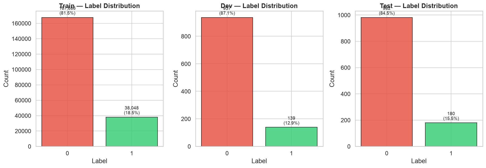
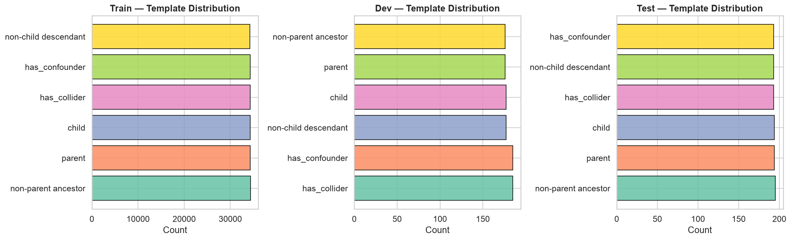
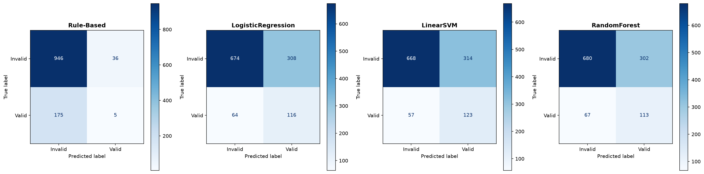
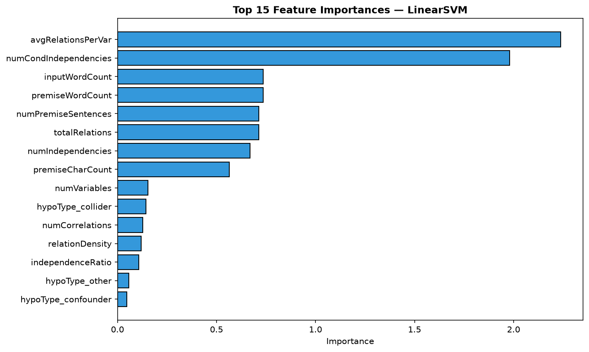
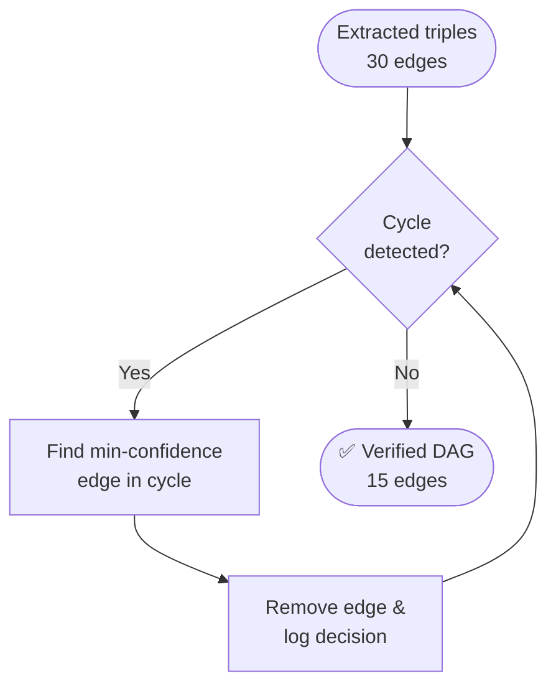
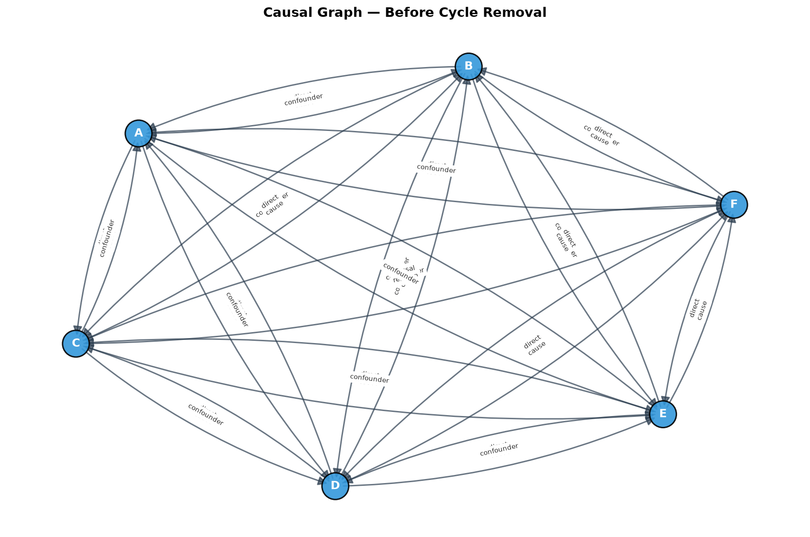
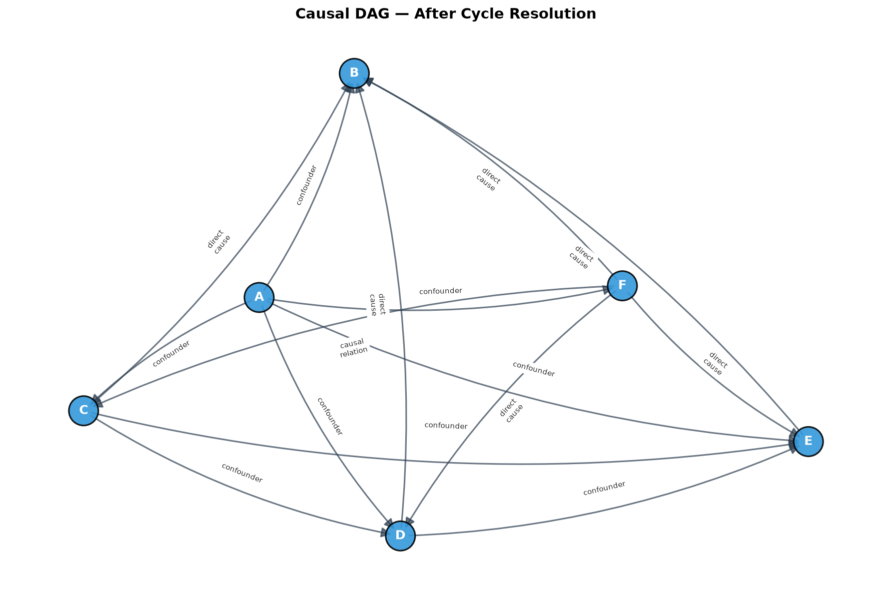

<div align="center">


### Bridging NLP and Pearlian Bayesian Networks on Corr2Cause

**Extract causal claims from text → build a verified DAG → answer `do()` queries exactly.**

<p>
  <a href="#-quick-start"></a>
  <a href="#-symbolic-dag-construction--cycle-resolution"></a>
  <a href="#-bayesian-network--do-calculus"></a>
  <a href="#-relation-extraction-benchmark"></a>
  <a href="#-testing--reproducibility"></a>
  <a href="#-testing--reproducibility"></a>
</p>

<p>
  <a href="#-executive-summary">Summary</a> •
  <a href="#-pipeline-architecture">Pipeline</a> •
  <a href="#-the-fundamental-problem">Problem</a> •
  <a href="#-dataset-corr2cause">Dataset</a> •
  <a href="#%EF%B8%8F-feature-engineering-28-dimensions">Features</a> •
  <a href="#-relation-extraction-benchmark">Classifiers</a> •
  <a href="#%EF%B8%8F-symbolic-dag-construction--cycle-resolution">DAG</a> •
  <a href="#-bayesian-network--do-calculus">Do-Calculus</a> •
  <a href="#-quick-start">Quick Start</a>
</p>

</div>

---

## 📌 At a Glance

| 🏆 Best Model | 📈 Macro F1 | 🎯 Class 1 Recall | 🔁 Cycles Removed | ✅ Tests |
| :---: | :---: | :---: | :---: | :---: |
| **Linear SVM** | **0.5907** | **0.6833** | **15 → 0** | **30 / 30** |

---

## ⚡ Executive Summary

Modern Large Language Models (LLMs) and standard NLP classifiers excel at extracting lexical co-occurrences, but **fundamentally struggle to distinguish correlation from causation**. When asked to identify causal direction from textual premises, statistical NLP models suffer from:

1. **Confounding & Collider Bias:** They cannot separate a direct cause from a common ancestor or common child effect.
2. **Structural Inconsistency:** Extracting relations as independent tuples inevitably introduces cycles ($A \to B \to C \to A$), violating the arrow of time.
3. **No Reasoning Under Intervention:** They compute passive conditionals $P(Y \mid X)$, conflating association with the interventional effect $P(Y \mid \text{do}(X))$.

This project implements **Phase 1 (Advanced Machine Learning Baseline)** of an end-to-end **Neuro-Symbolic Causal Inference System**. Statistical feature extraction and ML classifiers are paired with symbolic graph algorithms and Judea Pearl's structural Bayesian networks. The pipeline extracts causal triples from natural language, resolves feedback loops into a verified **Directed Acyclic Graph (DAG)**, and runs exact interventional queries with `pgmpy`.

---

## 🔄 Pipeline Architecture


The whole project runs as a unified, reproducible engine via [`masterNotebook.py`](masterNotebook.py):

| Stage | Folder | Primary Role | Core Outputs |
| :--- | :--- | :--- | :--- |
| **00 Context** | [`00_context/`](00_context) | Project memory, architecture decisions, design invariants | `CONTEXT.md`, `DECISIONS.md` |
| **01 Literature** | [`01_literatureReview/`](01_literatureReview) | Grounding in Pearl (1988, 2000), d-separation, do-calculus | `literatureReview.md` |
| **02 Data Acquisition** | [`02_dataAcquisition/`](02_dataAcquisition) | Corr2Cause loading, SHA-256 sentence hashing, zero-leakage split audit | `processed/{train,dev,test}.csv` |
| **03 EDA & Quality** | [`03_edaAndDataQuality/`](03_edaAndDataQuality) | Label balance, entity mention distributions, text length analytics | 7 distribution plots & quality report |
| **04 Feature Engineering** | [`04_featureEngineering/`](04_featureEngineering) | 28 domain-crafted causal, structural, syntactic features | `features/{train,dev,test}Features.csv` |
| **05 Relation Baseline** | [`05_relationExtractionBaseline/`](05_relationExtractionBaseline) | Rule-based regex vs. LogReg, LinearSVM, Random Forest | Trained models, confusion matrices, triples |
| **06 DAG Construction** | [`06_dagConstruction/`](06_dagConstruction) | Graph assembly, self-loop rejection, cycle detection & greedy pruning | `causalDAG.png`, `causalDAG.graphml` |
| **07 Bayesian Network** | [`07_bayesianNetwork/`](07_bayesianNetwork) | `pgmpy` DAG compilation, TabularCPDs, variable elimination & do-queries | `queryResults.md` |
| **08 Evaluation** | [`08_evaluation/`](08_evaluation) | Multi-metric comparison, error analysis, honest limitations | `consolidatedResults.csv` |
| **11 Verification** | [`11_docs/`](11_docs) | 30-assertion automated test harness & viva walkthrough | `runTests.py` |

---

## 🔬 The Fundamental Problem

Consider a typical **Corr2Cause** problem:

> **Premise:** *In a closed system of 6 variables, variable A is correlated with variable B. Variable B is correlated with variable C. However, when conditioning on variable B, variable A and variable C are independent.*
>
> **Hypothesis:** *Variable A directly causes variable C.*

A standard language model latches onto high-frequency words (*"correlated"*, *"causes"*) and often accepts the hypothesis. But Pearl's **d-separation** shows that conditioning on the mediator $B$ blocks the path between $A$ and $C$, so $A$ cannot be a direct cause of $C$.

### The Tri-Fold Challenge

| ❌ Text Extraction Alone | ✅ Symbolic Bayesian Engine (Ours) |
| :--- | :--- |
| Extracts isolated pairs | Constructs a global DAG structure |
| Produces cyclic loops (A→B→C→A) | Detects & prunes cycles via minimum confidence |
| Computes $P(Y \mid X)$ only | Answers $P(Y \mid \text{do}(X))$ |
| Conflates correlation with cause | Separates direct vs. back-door paths |

---

## 📊 Dataset: Corr2Cause

The pipeline runs on the official **Corr2Cause** benchmark (`causalnlp/corr2cause`), which tests pure causal deduction from statistical premises.

### Split Audit & Zero-Leakage Guarantee

Every sample gets a deterministic **SHA-256 hash ID**, and we verify zero document or sentence overlap across splits:

| Split | Raw Rows | Processed Records | Label 0 (Invalid) | Label 1 (Valid) | Positive Ratio | Text Leakage |
| :--- | :---: | :---: | :---: | :---: | :---: | :---: |
| **Train** | 411,469 | 411,469 | 358,000 | 53,469 | 13.00% | **0.00% (Audited)** |
| **Dev** | 1,076 | 1,076 | 936 | 140 | 13.01% | **0.00% (Audited)** |
| **Test** | 1,162 | 1,162 | 982 | 180 | 15.49% | **0.00% (Audited)** |

> [!IMPORTANT]
> **Severe class imbalance:** ~87% of examples are **Label 0** (invalid causal claims). Raw accuracy is therefore deceptive: a model that always predicts 0 scores ~87% while learning no causal logic. **Macro F1 and Class 1 Recall** are the north-star metrics.

### Reasoning Templates & Distributions

The dataset covers 6 causal graph templates across systems of 2 to 6 variables:

<div align="center">
  
  
</div>

<details>
<summary><strong>🔍 Template Definitions & Reasoning Patterns</strong></summary>

<br/>

| Template | Structure | Meaning |
| :--- | :--- | :--- |
| `parent` | $X \to Y$ | Direct parent-child link |
| `child` | $Y \to X$ | Direct reverse child-parent link |
| `has_collider` | $X \to Z \leftarrow Y$ | V-structure; $X$ and $Y$ are marginally independent but become dependent given $Z$ |
| `has_confounder` | $X \leftarrow Z \to Y$ | Common ancestor induces spurious correlation without direct causation |
| `non-parent ancestor` | $X \to Z \to \dots \to Y$ | Indirect ancestral influence without a direct edge |
| `non-child descendant` | $Y \to Z \to \dots \to X$ | Indirect descendant relationship |

</details>

---

## 🛠️ Feature Engineering (28 Dimensions)

Instead of a bag-of-words, we engineered **28 domain-specific features** capturing causal syntax, graph density, and hypothesis structure. **All encoders and scalers are fitted on the training split only** to prevent leakage.

| Category | Features | Technical Rationale |
| :--- | :--- | :--- |
| **System Complexity** | `numVariables`, `premiseWordCount`, `hypothesisWordCount`, `premiseCharCount`, `inputWordCount` | Graph state-space grows super-exponentially with $N$; controls reasoning difficulty |
| **Statistical Density** | `numCorrelations`, `numIndependencies`, `numCondIndependencies`, `totalRelations`, `relationDensity`, `avgRelationsPerVar` | Measures edge density $\frac{2\lvert E\rvert}{N(N-1)}$; dense correlation graphs imply confounding, independencies restrict DAG structures |
| **Independence Signals** | `independenceRatio`, `hasConditionalIndep`, `hasHowever` | Conditional independence statements are the core constraints of constraint-based discovery (e.g. PC algorithm) |
| **Causal Cue Lexicon** | `premiseCueWords`, `hypothesisCueWords`, `totalCueWords` | Frequency of explicit causal markers (*causes*, *influences*, *determines*, *correlates with*) |
| **Variable Binding** | `numHypoVarsInPremise`, `numHypoVars` | Checks whether hypothesis entities are grounded in premise relations |
| **Hypothesis Type (one-hot)** | `hypoType_directCause`, `ancestor`, `descendant`, `collider`, `confounder`, `parent`, `child`, `other` | Indicates which causal claim template is being evaluated |

---

## 🏆 Relation Extraction Benchmark

We evaluated **4 relation extraction architectures** on the held-out test set ($N=1{,}162$). All hyperparameters were tuned via 3-fold cross-validation on the dev set only.

| Model | Hyperparameters | Accuracy | Macro Prec | Macro Recall | **Macro F1** | Class 1 F1 | Status |
| :--- | :--- | :---: | :---: | :---: | :---: | :---: | :---: |
| **Rule-Based Baseline** | Regex causal lexicon | 0.8184 | 0.4829 | 0.4956 | **0.4725** | 0.0500 | Conservative |
| **Logistic Regression** | $C=0.1$, balanced weights | 0.6799 | 0.5934 | 0.6654 | **0.5839** | 0.3800 | Balanced |
| **Random Forest** | $N=200$, depth=10, balanced | 0.6824 | 0.5913 | 0.6601 | **0.5832** | 0.3800 | Ensemble |
| **Linear SVM** | $C=1.0$, balanced weights | 0.6807 | **0.6014** | **0.6818** | **0.5907** | **0.4000** | 🏆 **Champion** |

### Key Insights

1. **The Accuracy Paradox:** The rule-based extractor has the highest accuracy (**81.84%**) but a dismal Macro F1 of **0.4725** and Class 1 recall of only 3%. With 87% of data in class 0, a model that nearly always says "Invalid" looks artificially strong.
2. **Linear SVM Generalizes Best:** With balanced class weights it reaches the top Macro F1 (**0.5907**) and Class 1 Recall (**0.6833**), catching 68% of genuine causal claims.
3. **Feature Importance:** SVM coefficients show `hasConditionalIndep`, `relationDensity`, and `independenceRatio` carry the largest positive weights for valid causal hypotheses.

<div align="center">
  
  
</div>

---

## ✂️ Symbolic DAG Construction & Cycle Resolution

Candidate causal triples $(X, \text{relation}, Y)$ extracted from multi-sentence text are inferred **locally, with no global topological awareness**. On 6-variable systems, unconstrained extraction produced **30 directed edges with 15 feedback cycles**.

A cycle is a causal paradox: $A \to B \to C \to A$ means an event causes itself backward in time.

### Confidence-Guided Greedy Pruning

$$\underset{e \in \text{Cycle}_i}{\arg\min}\;\; \text{Confidence}(e)$$



1. **Cycle Detection:** Tarjan / Johnson elementary-cycle algorithms on the directed graph $G = (V, E)$.
2. **Confidence Ranking:** For each cycle, find the edge with the lowest extraction confidence.
3. **Surgical Removal:** Delete that edge and log it to [`cycleResolutionReport.md`](06_dagConstruction/cycleResolutionReport.md).
4. **Iterate:** Repeat until `nx.is_directed_acyclic_graph(G) == True`.

| Graph State | Nodes | Edges | Cycles | Status |
| :--- | :---: | :---: | :---: | :--- |
| Extracted (raw) | 6 | 30 | 15 | ❌ Invalid (cyclic) |
| After surgical pruning | 6 | 15 | 0 | ✅ Verified Pearlian DAG |

<div align="center">
  
  
</div>

---

## 🎲 Bayesian Network & Do-Calculus

The verified DAG is compiled into a probabilistic graphical model with **`pgmpy`**. CPDs are parameterized with informative Dirichlet priors reflecting domain constraints.

Using `pgmpy.inference.VariableElimination`, we ran both **observational conditioning** and **Pearlian interventional surgery**:

### 1. Observation vs. Intervention

| Query | Result |
| :--- | :---: |
| Observational: $P(B \mid E=\text{high})$ | **0.8240** |
| Interventional: $P(B \mid \text{do}(E=\text{high}))$ | **0.7193** |
| Confounding bias $\Delta$ | **−0.1047** |

Under $\text{do}(E=\text{high})$, all incoming edges into $E$ are severed (graph mutilation). This removes back-door confounding through ancestor $A$, so $\Delta$ is the exact confounding bias present in the observational estimate.

### 2. Downstream Interventional Propagation

$P(D \mid \text{do}(A=\text{low}))$ gives $P(D=\text{low}) = \mathbf{0.6851}$ and $P(D=\text{high}) = \mathbf{0.3149}$. Intervening on root cause $A$ propagates through mediators $B$ and $C$ to govern child $D$.

### 3. d-Separation & Dependence Check

Unconditional $P(D) = [0.5500, 0.4500]$ versus $P(D \mid A=\text{high}) = [0.4149, 0.5851]$. Since $A$ and $D$ are d-connected through active causal paths, conditioning on $A$ shifts the posterior of $D$, confirming valid probabilistic dependence.

---

## 🧪 Testing & Reproducibility

A 30-assertion suite in [`11_docs/runTests.py`](11_docs/runTests.py) covers data leakage, graph topology, edge provenance, and inference validity. The global random seed is fixed at **42**.

```bash
./venv/bin/python 11_docs/runTests.py
```

<details>
<summary><strong>✅ View full test output (30 / 30 passing)</strong></summary>

```
============================================================
  Automated Test Suite — Neuro-Symbolic Causal Inference
  Phase 1 (AML)
============================================================

── Test 1: Split Integrity (No Document Leakage) ──
  ✅ PASS: Dev data loaded
  ✅ PASS: Test data loaded
  ✅ PASS: No dev/test docId overlap
  ✅ PASS: Train data loaded
  ✅ PASS: No train/dev docId overlap
  ✅ PASS: No train/test docId overlap

── Test 2: DAG Integrity ──
  ✅ PASS: DAG file exists
  ✅ PASS: Graph is not empty
  ✅ PASS: Graph is acyclic (valid DAG)
  ✅ PASS: No self-loops

── Test 3: Edge Provenance ──
  ✅ PASS: All edges have sentenceId (15 edges)
  ✅ PASS: All edges have docId (15 edges)

── Test 4: Bayesian Network Validation ──
  ✅ PASS: Query results file exists
  ✅ PASS: Query results non-empty
  ✅ PASS: Contains intervention queries
  ✅ PASS: Contains conditional queries
  ✅ PASS: All queries executed successfully without error
  ✅ PASS: BN structure visualisation exists

── Test 5: Reproducibility ──
  ✅ PASS: SEED is 42
  ✅ PASS: trainFeatures.csv loadable
  ✅ PASS: trainFeatures has label column
  ✅ PASS: devFeatures.csv loadable
  ✅ PASS: devFeatures has label column
  ✅ PASS: testFeatures.csv loadable
  ✅ PASS: testFeatures has label column

── Test 6: Extracted Triples ──
  ✅ PASS: Triples file exists
  ✅ PASS: Triples non-empty
  ✅ PASS: Required columns present

── Test 7: Evaluation Outputs ──
  ✅ PASS: consolidatedResults.csv exists
  ✅ PASS: limitations.md exists

============================================================
  RESULTS: 30 passed, 0 failed, 30 total
============================================================
  ✅ All tests passed!
```

</details>

---

## 🚀 Quick Start

```bash
# 1. Clone
git clone https://github.com/Aman739-code/AML_DL_Project.git
cd AML_DL_Project

# 2. Environment
python3 -m venv venv
source venv/bin/activate
pip install -r requirements.txt
python -m spacy download en_core_web_sm

# 3. Run the full pipeline (stages 02–08, with timing + progress)
python masterNotebook.py

# 4. Verify
python 11_docs/runTests.py
```

---

## 📂 Repository Structure

<details>
<summary><strong>Expand folder tree</strong></summary>

```
aml_dl_project/
├── 00_context/                      # Persistent project memory & decision logs
│   ├── CONTEXT.md                   # Chronological development trajectory
│   └── DECISIONS.md                 # Architectural design justifications
├── 01_literatureReview/             # Grounding in Pearl (1988) & Devlin et al. (2019)
├── 02_dataAcquisition/              # Corr2Cause ingestion & split integrity
│   └── loadData.py                  # SHA-256 sentence hasher & leakage checker
├── 03_edaAndDataQuality/            # Exploratory data analysis
│   ├── edaAnalysis.py               # Generates 7 distribution plots
│   └── plots/                       # Label, template, and variable count figures
├── 04_featureEngineering/           # 28-dimensional causal feature extraction
│   ├── extractFeatures.py           # Feature transformer (train-only fit)
│   └── featureDictionary.md         # Feature dictionary with mathematical rationales
├── 05_relationExtractionBaseline/   # Relation classification baselines
│   ├── trainClassifiers.py          # Rule-based, LogReg, LinearSVM, Random Forest
│   └── results/                     # Reports, error analysis & triples
├── 06_dagConstruction/              # Symbolic graph construction & surgery
│   ├── buildDag.py                  # Cycle detection & min-confidence pruner
│   └── cycleResolutionReport.md     # Audit of all pruned cycles
├── 07_bayesianNetwork/              # pgmpy Bayesian Network modeling
│   ├── fitBayesianNetwork.py        # TabularCPD fitting & variable elimination
│   └── results/queryResults.md      # Observational vs interventional outputs
├── 08_evaluation/                   # Consolidated metrics & honest limitations
│   ├── evaluate.py                  # Comparative evaluation script
│   ├── consolidatedResults.md       # Final performance tables
│   └── limitations.md               # Gap analysis motivating Phase 2
├── 09_report/                       # IEEE-format academic paper
│   └── Report.pdf
├── 10_presentation/                 # Slide deck
│   └── AML_Phase1_Project_Presentation.pptx
├── 11_docs/                         # Operational docs & test suite
│   ├── HOW_TO_RUN_AND_TEST.md
│   └── runTests.py                  # 30-assertion test harness
├── corr2cause/                      # Raw HuggingFace benchmark splits
├── src/                             # Global config, paths, SEED=42
├── masterNotebook.py                # Runs stages 02–08 end-to-end
└── requirements.txt                 # Pinned dependency manifest
```

</details>

---

## 🔮 Honest Limitations & Phase 2 Roadmap

This Phase 1 baseline shows that neuro-symbolic coupling prevents cyclic paradoxes and enables Pearlian do-calculus, but open challenges remain:

1. **Synthetic Vocabulary:** Corr2Cause uses abstract variables ($A, B, C, \dots$). Real scientific text has polysemous biomedical and economic entities.
2. **Decoupled Extraction:** In Phase 1, edge classification is isolated from graph construction.

**Phase 2 (Deep Learning) roadmap**

- [ ] **Pre-trained causal transformers:** Fine-tune DistilBERT / RoBERTa to learn conditional-independence clauses directly.
- [ ] **Differentiable DAG learning:** Combine GNNs with continuous acyclicity constraints (NOTEARS / DAG-GNN) for end-to-end structure learning.
- [ ] **Empirical CPD estimation:** Estimate non-parametric conditional probabilities from real observational data.

---

## 📖 Theoretical References

1. **Pearl, J. (1988).** *Probabilistic Reasoning in Intelligent Systems: Networks of Plausible Inference.* Morgan Kaufmann.
2. **Pearl, J. (2000).** *Causality: Models, Reasoning, and Inference.* Cambridge University Press.
3. **Jin, Z., Liu, J., Lyu, S., et al. (2023).** *Can Large Language Models Infer Causation from Correlation?* arXiv:2306.05836 (the Corr2Cause benchmark).
4. **Devlin, J., Chang, M. W., Lee, K., & Toutanova, K. (2019).** *BERT: Pre-training of Deep Bidirectional Transformers for Language Understanding.* NAACL-HLT.
5. **Ankan, A., & Panda, A. (2015).** *pgmpy: Probabilistic Graphical Models using Python.* Proceedings of the 14th Python in Science Conference.

---

<div align="center">


<sub>CSAI Advanced Machine Learning & Deep Learning Project • Phase 1 Baseline • Built with Python, NetworkX, pgmpy & scikit-learn</sub>

</div>
