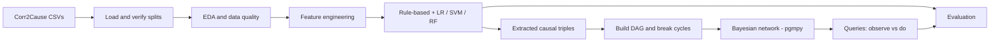

<p align="center">
  
</p>

<p align="center">
  
  
  
  
  
  
</p>

> **Idea in one line:** read causal claims out of text, assemble them into a directed acyclic graph, turn the graph into a Bayesian network, and ask it interventional questions such as `P(B | do(E = high))`.

---

## Pipeline

<p align="center">
  
</p>



## Results

<p align="center">
  
</p>

| Model | Test accuracy | Test macro-F1 |
|---|---|---|
| Predict all-0 (reference) | 0.845 | 0.458 |
| Rule-based | 0.818 | 0.472 |
| Logistic Regression | 0.680 | 0.584 |
| Random Forest | 0.682 | 0.583 |
| **Linear SVM** | 0.681 | **0.591** |

The test set is 84.5% label 0, so accuracy is misleading and **macro-F1** is the metric to read.

## Quick start

```bash
python -m venv venv && source venv/bin/activate
pip install -r requirements.txt

python masterNotebook.py      # runs stages 02-08 end to end (SEED = 42)
python runTests.py            # automated checks
```

## Repository map

<details>
<summary><b>Click to expand</b></summary>

| Folder | What it does |
|---|---|
| `00_context/` | Project context and design decisions |
| `02_dataAcquisition/` | Loads Corr2Cause, builds `processed/` splits, verifies them |
| `03_edaAndDataQuality/` | Label balance, length stats, plots, quality summary |
| `04_featureEngineering/` | `extractFeatures.py` and the feature dictionary |
| `05_relationExtractionBaseline/` | Rule-based classifier, LR / SVM / RF, triple extraction |
| `06_dagConstruction/` | Triples to NetworkX graph, cycle detection and removal |
| `07_bayesianNetwork/` | pgmpy network, observational vs `do()` queries |
| `08_evaluation/` | Consolidated results and limitations |
| `09_report/` | LaTeX report |
| `10_presentation/` | Slide outline |
| `11_docs/` | Codebase explanation, how to run, viva preparation |

</details>

## Known limitations (read before citing numbers)

- **CPDs are hand-set priors**, not learned from data, because the corpus has no observational samples. Query results show the mechanics of `P(Y | X)` versus `P(Y | do(X))`; they are not empirical causal estimates.
- **Triples carry a constant confidence of 1.0**, so cycle removal falls back to an arbitrary tie-break.
- **Claims from independent examples are merged into one graph** over the letters A to F, which have different meanings in every example.
- **Hyperparameters are tuned with 3-fold CV on the training split**; the dev split is not used for tuning.
- Several engineered columns are constant, and the `parent` and `child` hypothesis types are merged.

---

<p align="center"><sub>Advanced Machine Learning · Phase 1 · Seed 42</sub></p>
